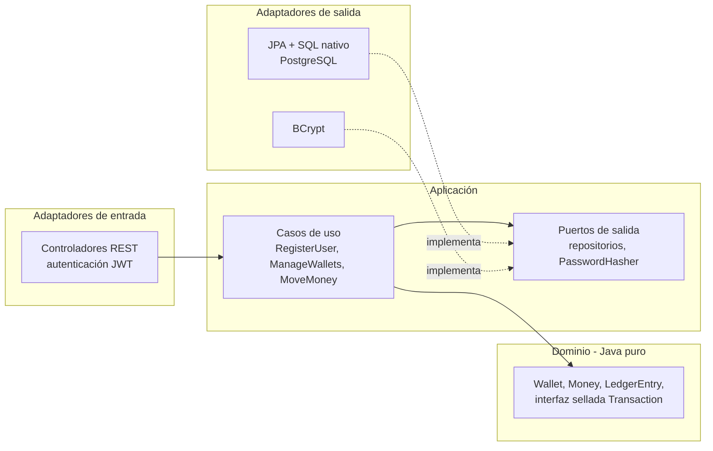

# Digital Wallet API

[](https://github.com/Adri23Ausin/digital-wallet-api/actions/workflows/ci.yml)


[English](README.md) | **Español**

Una API REST de monedero digital multidivisa: los usuarios abren monederos, ingresan, retiran y se envían dinero entre ellos. Está construida en torno a las partes difíciles de mover dinero: **importes que nunca pierden un céntimo, saldos que no pueden quedar en negativo, peticiones que se pueden reintentar sin riesgo y actualizaciones concurrentes que nunca corrompen un saldo**. El código sigue una arquitectura hexagonal verificada mediante tests.

### Autor: Adrián Ausín Cuesta

## Contenido

1. [Funcionalidades](#funcionalidades)
2. [Stack tecnológico](#stack-tecnológico)
3. [Arquitectura](#arquitectura)
4. [Cómo ejecutarlo](#cómo-ejecutarlo)
5. [API](#api)
6. [Cómo se garantiza que el dinero cuadre](#cómo-se-garantiza-que-el-dinero-cuadre)
7. [Tests](#tests)
8. [Decisiones de diseño](#decisiones-de-diseño)
9. [Posibles mejoras](#posibles-mejoras)

## Funcionalidades

- **Cuentas**: registro e inicio de sesión con contraseñas cifradas con BCrypt y tokens de acceso JWT de corta duración.
- **Monederos**: un monedero por divisa y usuario, en cualquier divisa ISO 4217.
- **Movimientos de dinero**: ingresos, retiradas y transferencias entre usuarios, con un libro de movimientos de solo inserción (append-only) e historial paginado.
- **Idempotencia**: todo movimiento exige un `Idempotency-Key`, de modo que una petición reintentada nunca mueve el dinero dos veces.
- **Seguridad ante concurrencia**: bloqueo optimista con reintentos automáticos, ordenación libre de interbloqueos y restricciones de base de datos como última línea de defensa.
- **Privacidad por defecto**: los monederos de otros usuarios responden `404`, así que no se pueden sondear identificadores de monedero.
- **Errores como problem details RFC 9457**, mapeados de forma exhaustiva a partir de jerarquías de excepciones selladas.
- Documentación **OpenAPI 3.1** con Swagger UI (y un botón de autenticación Bearer).

## Stack tecnológico

| Área | Tecnología |
|---|---|
| Lenguaje | Java 21 (records, interfaces selladas, pattern matching en `switch`, hilos virtuales) |
| Framework | Spring Boot 4.1, Spring MVC, Spring Data JPA (Hibernate 7) |
| Seguridad | Spring Security 7, OAuth2 Resource Server (JWT HS256), BCrypt |
| Base de datos | PostgreSQL 17, migraciones con Flyway |
| Resiliencia | `RetryTemplate` de Spring Framework 7 (backoff exponencial + jitter) |
| Documentación de la API | springdoc-openapi 3 |
| Tests | JUnit 5, AssertJ, `MockMvcTester`, Testcontainers, ArchUnit |
| Build y despliegue | Maven wrapper, imagen Docker multi-stage, Docker Compose, GitHub Actions |

## Arquitectura

Hexagonal (puertos y adaptadores). El dominio es Java puro, la capa de aplicación define los casos de uso y los puertos que necesita, y los adaptadores conectan el mundo exterior. [`ArchitectureTest`](src/test/java/com/adrianausin/wallet/ArchitectureTest.java) hace fallar el build si alguna dependencia apunta en la dirección equivocada.



```
src/main/java/com/adrianausin/wallet
├── domain/                     # Agregado Wallet, Money, LedgerEntry, Transaction, errores de dominio
├── application/
│   ├── port/in/                # Interfaces de casos de uso y comandos
│   ├── port/out/               # Puertos de repositorio y de hashing
│   └── service/                # Implementación de casos de uso, idempotencia, reintentos
├── adapter/
│   ├── in/web/                 # Controladores, DTOs, mapeo a problem details, endpoints de autenticación
│   ├── out/persistence/        # Entidades JPA, repositorios Spring Data, adaptadores
│   └── out/security/           # Hasher de contraseñas BCrypt
└── config/                     # Configuración de seguridad (JWT) y OpenAPI
```

## Cómo ejecutarlo

Requiere **Docker**. Para ejecutarlo fuera de Docker también necesitas **JDK 21**.

### Todo en Docker

```bash
docker compose --profile app up --build
```

La API queda en http://localhost:8080 y Swagger UI en http://localhost:8080/swagger-ui.html.

### API en tu máquina, base de datos en Docker

```bash
docker compose up -d postgres
./mvnw spring-boot:run        # macOS / Linux
.\mvnw.cmd spring-boot:run    # Windows
```

> La clave de firma JWT de `application.yml` es solo para desarrollo local. En cualquier otro entorno define `JWT_SECRET` (en base64, al menos 256 bits, p. ej. `openssl rand -base64 32`).

## API

[`requests.http`](requests.http) contiene el flujo completo listo para ejecutar desde IntelliJ o VS Code.

| Método | Ruta | Descripción |
|---|---|---|
| `POST` | `/api/v1/auth/register` | Crear una cuenta |
| `POST` | `/api/v1/auth/login` | Obtener un token de acceso (15 min) |
| `POST` | `/api/v1/wallets` | Abrir un monedero `{"currency": "EUR"}` |
| `GET` | `/api/v1/wallets` | Listar tus monederos |
| `GET` | `/api/v1/wallets/{id}` | Obtener uno de tus monederos |
| `GET` | `/api/v1/wallets/{id}/transactions?page=0&size=20` | Movimientos del libro, los más recientes primero |
| `POST` | `/api/v1/wallets/{id}/deposits` | Ingresar `{"amount": 250.00}`, requiere `Idempotency-Key` |
| `POST` | `/api/v1/wallets/{id}/withdrawals` | Retirar `{"amount": 40.50}`, requiere `Idempotency-Key` |
| `POST` | `/api/v1/transfers` | Transferir a cualquier monedero de la misma divisa, requiere `Idempotency-Key` |

```bash
TOKEN=$(curl -s -X POST localhost:8080/api/v1/auth/login -H 'Content-Type: application/json' \
  -d '{"email":"ana@example.com","password":"correct-horse-battery"}' | jq -r .accessToken)

curl -i -X POST localhost:8080/api/v1/wallets/$WALLET/deposits \
  -H "Authorization: Bearer $TOKEN" -H 'Idempotency-Key: deposit-0001' \
  -H 'Content-Type: application/json' -d '{"amount": 250}'
```

```
HTTP/1.1 201
Idempotent-Replayed: false

{"id":"95f8f936-...","type":"DEPOSIT","amount":250.00,"currency":"EUR","targetWalletId":"a2ec9b23-...", ...}
```

Si se envía de nuevo la misma petición, se devuelve la misma transacción con `Idempotent-Replayed: true` y el saldo no cambia.

| Código | Cuándo |
|---|---|
| `400` | Errores de validación, divisa desconocida, más decimales de los que admite la divisa, falta el `Idempotency-Key` |
| `401` | Token ausente, caducado o manipulado, o credenciales incorrectas |
| `404` | El monedero no existe **o pertenece a otra persona** |
| `409` | Email o monedero duplicado, o un monedero que sigue en conflicto tras agotar los reintentos (reintenta con la misma clave) |
| `422` | Saldo insuficiente, divisas distintas, `Idempotency-Key` reutilizado con un cuerpo diferente |

## Cómo se garantiza que el dinero cuadre

**Importes.** `Money` es un `BigDecimal` más una `Currency`, siempre con la escala de la unidad mínima de la divisa. `10.001 EUR` o `1.5 JPY` se rechazan en lugar de redondearse, porque redondear dinero de forma silenciosa es un bug.

**Saldos.** Un `Wallet` solo cambia su saldo mediante `credit` y `debit`, y cada llamada devuelve el `LedgerEntry` que lo justifica. Los apuntes son de solo inserción y guardan el saldo resultante tras el movimiento, así que el saldo siempre se puede cotejar con el libro (los tests de concurrencia hacen exactamente eso). Las restricciones `CHECK` de PostgreSQL rechazan saldos negativos y transacciones incoherentes aunque un bug se haya saltado el dominio.

**Los reintentos son seguros (idempotencia).** El `Idempotency-Key` se reclama con `INSERT ... ON CONFLICT DO NOTHING` *en la misma transacción de base de datos* que el movimiento de dinero:

- Primera petición: se inserta la clave, se ejecuta el movimiento y ambos se confirman juntos.
- Reintento tras un éxito: el insert choca con la clave existente y se devuelve la transacción almacenada.
- Duplicado concurrente: PostgreSQL hace que el segundo insert espere a la fila aún no confirmada de la primera transacción; después ve la clave y reproduce la respuesta. El dinero nunca se mueve dos veces.
- Misma clave, cuerpo distinto: la huella SHA-256 almacenada no coincide, así que la API responde `422`.

**Actualizaciones concurrentes (bloqueo optimista).** Los monederos llevan un `@Version`. Si dos peticiones actualizan el mismo monedero, una falla con una excepción de bloqueo optimista. Un decorador reintenta entonces *la transacción completa* (backoff exponencial con jitter), recargando saldos actualizados en cada intento. Las actualizaciones se vuelcan en orden de clave primaria (`hibernate.order_updates`), de modo que las transferencias `A→B` y `B→A` bloquean las filas en el mismo orden y no pueden provocar un interbloqueo.

## Tests

```bash
./mvnw verify    # requiere Docker en ejecución para Testcontainers
```

64 tests:

| Tipo | Qué cubren |
|---|---|
| Tests unitarios de dominio | Reglas de escala de `Money`, invariantes del monedero, validación de transferencias |
| Tests de casos de uso | Contra implementaciones en memoria de los puertos (sin mocks ni base de datos): movimientos, propiedad, idempotencia, reintentos |
| `@DataJpaTest` + Testcontainers | Mapeos, esquema de Flyway, bloqueo optimista, restricciones de base de datos |
| End-to-end sobre HTTP + Testcontainers | Autenticación, monederos, transferencias, privacidad, respuestas idempotentes, peticiones duplicadas concurrentes |
| Tests de concurrencia | 20 retiradas en paralelo y 30 transferencias cruzadas, comprobando que no hay descubiertos, que el total se conserva y que saldo = libro |
| ArchUnit | Reglas de dependencias de la arquitectura hexagonal |

## Decisiones de diseño

- **Arquitectura hexagonal, con pragmatismo.** El dominio es Java puro. La capa de aplicación usa `@Service` y `@Transactional` de Spring, pero nunca tipos web, de seguridad o de JPA. Así las reglas de negocio se pueden testear sin contenedor y sin inventar abstracciones sobre las transacciones.
- **Bloqueo optimista en lugar de pesimista.** La mayoría de monederos tienen poca contención, así que el bloqueo optimista evita mantener bloqueos de fila. La contrapartida aparece con contención extrema sobre un mismo monedero: algunas peticiones agotan sus reintentos y reciben un `409`. Como toda petición lleva una clave de idempotencia, reintentar siempre es seguro.
- **El reintento envuelve la transacción.** Reintentar dentro de una transacción que ya ha fallado reutilizaría datos obsoletos. Por eso los reintentos viven en un decorador alrededor del servicio transaccional en lugar de en un `@Retryable` sobre el mismo método.
- **Idempotencia en la base de datos, no en memoria.** La clave se confirma o se deshace junto con el movimiento de dinero, así que no hay ningún momento en que exista una sin la otra, ni siquiera con varias instancias de la API.
- **El login no revela qué emails existen.** Una contraseña incorrecta y un email desconocido devuelven el mismo mensaje, y el caso del email desconocido comprueba igualmente un hash BCrypt ficticio para que ambos tarden lo mismo.
- **Jerarquías selladas para transacciones y errores.** Añadir un nuevo tipo de transacción o de error sin tratarlo en el mapeo de persistencia, en las respuestas de la API y en el mapeo de códigos HTTP es un error de compilación.

## Posibles mejoras

- Refresh tokens y revocación de tokens.
- Conversión de divisas entre monederos, usando un servicio de tipos de cambio como [fx-rate-service](https://github.com/Adri23Ausin/fx-rate-service).
- Una tarea programada que elimine las claves de idempotencia con más de 24 horas.
- Publicación de eventos de transacción (transactional outbox) para notificaciones y analítica.
- Métricas y trazas con Micrometer y OpenTelemetry.

## Licencia

[MIT](LICENSE)
