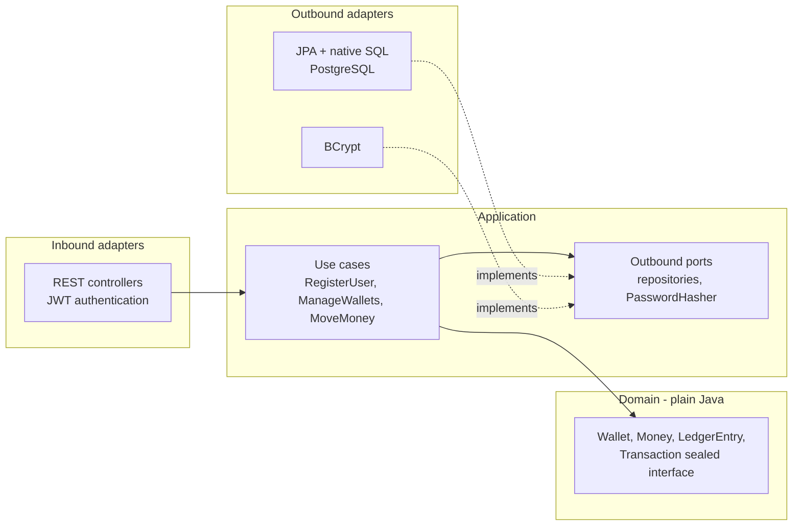

# Digital Wallet API

[](https://github.com/Adri23Ausin/digital-wallet-api/actions/workflows/ci.yml)


**English** | [Español](README.es.md)

A multi-currency digital wallet REST API: users open wallets, deposit, withdraw and send money to each other. It is built around the hard parts of moving money: **amounts that never lose a cent, balances that can't go negative, requests that are safe to retry, and concurrent updates that never corrupt a balance**. The code follows a hexagonal architecture enforced by tests.

### Author: Adrián Ausín Cuesta

## Contents

1. [Features](#features)
2. [Tech stack](#tech-stack)
3. [Architecture](#architecture)
4. [Run it](#run-it)
5. [API](#api)
6. [How money stays correct](#how-money-stays-correct)
7. [Tests](#tests)
8. [Design decisions](#design-decisions)
9. [Possible improvements](#possible-improvements)

## Features

- **Accounts**: registration and login with BCrypt-hashed passwords and short-lived JWT access tokens.
- **Wallets**: one wallet per currency per user, any ISO 4217 currency.
- **Money movements**: deposits, withdrawals and transfers between users, with an append-only ledger and paginated history.
- **Idempotency**: every movement requires an `Idempotency-Key`, so a retried request never moves money twice.
- **Concurrency safety**: optimistic locking with automatic retries, deadlock-free ordering and database constraints as a last line of defence.
- **Privacy by default**: other users' wallets answer `404`, so wallet ids can't be probed.
- **Errors as RFC 9457 problem details**, mapped exhaustively from sealed exception hierarchies.
- **OpenAPI 3.1** docs with Swagger UI (and a Bearer auth button).

## Tech stack

| Area | Technology |
|---|---|
| Language | Java 21 (records, sealed interfaces, pattern matching for `switch`, virtual threads) |
| Framework | Spring Boot 4.1, Spring MVC, Spring Data JPA (Hibernate 7) |
| Security | Spring Security 7, OAuth2 Resource Server (HS256 JWT), BCrypt |
| Database | PostgreSQL 17, Flyway migrations |
| Resilience | Spring Framework 7 `RetryTemplate` (exponential backoff + jitter) |
| API docs | springdoc-openapi 3 |
| Tests | JUnit 5, AssertJ, `MockMvcTester`, Testcontainers, ArchUnit |
| Build & delivery | Maven wrapper, multi-stage Docker image, Docker Compose, GitHub Actions |

## Architecture

Hexagonal (ports and adapters). The domain is plain Java, the application layer defines the use cases and the ports it needs, and adapters plug the outside world in. [`ArchitectureTest`](src/test/java/com/adrianausin/wallet/ArchitectureTest.java) fails the build if a dependency points the wrong way.



```
src/main/java/com/adrianausin/wallet
├── domain/                     # Wallet aggregate, Money, LedgerEntry, Transaction, domain errors
├── application/
│   ├── port/in/                # Use case interfaces and commands
│   ├── port/out/               # Repository and hashing ports
│   └── service/                # Use case implementations, idempotency, retries
├── adapter/
│   ├── in/web/                 # Controllers, DTOs, problem-detail mapping, auth endpoints
│   ├── out/persistence/        # JPA entities, Spring Data repositories, adapters
│   └── out/security/           # BCrypt password hasher
└── config/                     # Security (JWT) and OpenAPI configuration
```

## Run it

Requires **Docker**. To run outside Docker you also need **JDK 21**.

### Everything in Docker

```bash
docker compose --profile app up --build
```

The API is at http://localhost:8080 and Swagger UI at http://localhost:8080/swagger-ui.html.

### API on your machine, database in Docker

```bash
docker compose up -d postgres
./mvnw spring-boot:run        # macOS / Linux
.\mvnw.cmd spring-boot:run    # Windows
```

> The JWT signing key in `application.yml` is for local development only. Set `JWT_SECRET` (base64, at least 256 bits, e.g. `openssl rand -base64 32`) anywhere else.

## API

[`requests.http`](requests.http) has the whole flow ready to run from IntelliJ or VS Code.

| Method | Path | Description |
|---|---|---|
| `POST` | `/api/v1/auth/register` | Create an account |
| `POST` | `/api/v1/auth/login` | Get an access token (15 min) |
| `POST` | `/api/v1/wallets` | Open a wallet `{"currency": "EUR"}` |
| `GET` | `/api/v1/wallets` | List your wallets |
| `GET` | `/api/v1/wallets/{id}` | Get one of your wallets |
| `GET` | `/api/v1/wallets/{id}/transactions?page=0&size=20` | Ledger entries, newest first |
| `POST` | `/api/v1/wallets/{id}/deposits` | Deposit `{"amount": 250.00}`, needs `Idempotency-Key` |
| `POST` | `/api/v1/wallets/{id}/withdrawals` | Withdraw `{"amount": 40.50}`, needs `Idempotency-Key` |
| `POST` | `/api/v1/transfers` | Transfer to any wallet in the same currency, needs `Idempotency-Key` |

```bash
TOKEN=$(curl -s -X POST localhost:8080/api/v1/auth/login -H 'Content-Type: application/json' \
  -d '{"email":"ana@example.com","password":"correct-horse-battery"}' | jq -r .accessToken)

curl -i -X POST localhost:8080/api/v1/wallets/$WALLET/deposits \
  -H "Authorization: Bearer $TOKEN" -H 'Idempotency-Key: deposit-0001' \
  -H 'Content-Type: application/json' -d '{"amount": 250}'
```

```
HTTP/1.1 201
Idempotent-Replayed: false

{"id":"95f8f936-...","type":"DEPOSIT","amount":250.00,"currency":"EUR","targetWalletId":"a2ec9b23-...", ...}
```

Sending the same request again returns the same transaction with `Idempotent-Replayed: true`, and the balance doesn't change.

| Status | When |
|---|---|
| `400` | Validation errors, unknown currency, more decimals than the currency allows, missing `Idempotency-Key` |
| `401` | Missing, expired or tampered token, or wrong credentials |
| `404` | The wallet doesn't exist **or belongs to someone else** |
| `409` | Duplicate email or wallet, or a wallet still contended after all retries (retry with the same key) |
| `422` | Insufficient funds, currency mismatch, `Idempotency-Key` reused with a different body |

## How money stays correct

**Amounts.** `Money` is a `BigDecimal` plus a `Currency`, always at the currency's minor-unit scale. `10.001 EUR` or `1.5 JPY` is rejected rather than rounded, because silently rounding money is a bug.

**Balances.** A `Wallet` changes its balance only through `credit` and `debit`, and each call returns the `LedgerEntry` that explains it. Entries are append-only and store the balance after the movement, so the balance can always be checked against the ledger (the concurrency tests do exactly that). PostgreSQL `CHECK` constraints reject negative balances and inconsistent transactions even if a bug got past the domain.

**Retries are safe (idempotency).** The `Idempotency-Key` is claimed with `INSERT ... ON CONFLICT DO NOTHING` *in the same database transaction* as the money movement:

- First request: the key is inserted, the movement runs, both commit together.
- Retry after success: the insert hits the existing key and the stored transaction is returned.
- Concurrent duplicate: PostgreSQL makes the second insert wait on the first transaction's uncommitted row, then it sees the key and replays. The money never moves twice.
- Same key, different body: the stored SHA-256 fingerprint doesn't match, so the API answers `422`.

**Concurrent updates (optimistic locking).** Wallets carry a `@Version`. If two requests update the same wallet, one fails with an optimistic locking exception. A decorator then retries the *whole transaction* (exponential backoff with jitter), reloading fresh balances each time. Updates are flushed in primary-key order (`hibernate.order_updates`), so `A→B` and `B→A` transfers lock rows in the same order and can't deadlock.

## Tests

```bash
./mvnw verify    # needs Docker running for Testcontainers
```

64 tests:

| Kind | What they cover |
|---|---|
| Domain unit tests | Money scale rules, wallet invariants, transfer validation |
| Use case tests | Against in-memory fakes of the ports (no mocks, no database): movements, ownership, idempotency, retries |
| `@DataJpaTest` + Testcontainers | Mappings, Flyway schema, optimistic locking, DB constraints |
| End-to-end over HTTP + Testcontainers | Auth, wallets, transfers, privacy, idempotent replays, concurrent duplicate requests |
| Concurrency tests | 20 parallel withdrawals and 30 opposite transfers, checking no overdraft, conserved totals and balance = ledger |
| ArchUnit | Hexagonal dependency rules |

## Design decisions

- **Hexagonal architecture, pragmatically.** The domain is pure Java. The application layer uses Spring's `@Service` and `@Transactional`, but never web, security or JPA types. That keeps the business rules testable without a container, without inventing abstractions over transactions.
- **Optimistic over pessimistic locking.** Most wallets see little contention, so optimistic locking avoids holding row locks. The trade-off shows under extreme contention on one wallet: some requests run out of retries and get a `409`. Because every request carries an idempotency key, retrying is always safe.
- **The retry wraps the transaction.** Retrying inside a transaction that already failed would reuse stale data. That's why retries live in a decorator around the transactional service instead of a `@Retryable` on the same method.
- **Idempotency in the database, not in memory.** The key commits or rolls back together with the money movement, so there is no window where one exists without the other, even across several API instances.
- **Login doesn't reveal which emails exist.** Wrong password and unknown email return the same message, and the unknown-email path still checks a dummy BCrypt hash so both take the same time.
- **Sealed hierarchies for transactions and errors.** Adding a new transaction type or error without handling it in persistence mapping, API responses and HTTP status mapping is a compile error.

## Possible improvements

- Refresh tokens and token revocation.
- Currency conversion between wallets, using a rate service such as [fx-rate-service](https://github.com/Adri23Ausin/fx-rate-service).
- A scheduled job that deletes idempotency keys older than 24 hours.
- Publishing transaction events (transactional outbox) for notifications and analytics.
- Metrics and tracing with Micrometer and OpenTelemetry.

## License

[MIT](LICENSE)
